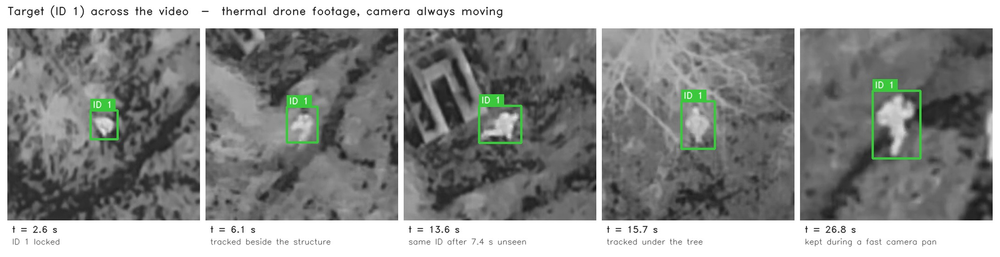
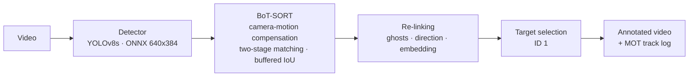
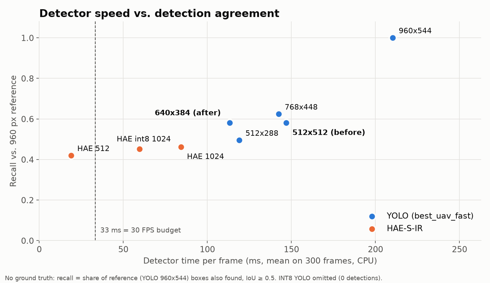

# Thermal Person Tracking

Real-time, CPU-based tracking of **one walking person** in white-hot thermal drone video. The person may be partly or fully hidden for seconds, change appearance, and blend into the background, so the system combines spatial and temporal reasoning to keep the target's identity.

The target is always shown as **ID 1**. Other people and hot objects are tracked too, as distractors (IDs 2, 3, …).



## How it works

**Detect everyone, track everyone, follow one.**



| Stage | What it solves |
|---|---|
| **Detector:** YOLOv8s fine-tuned on drone views of people, ONNX at 640×384 (the portrait video's aspect ratio, no square padding) | Finds people as 10–20 px warm blobs |
| **BoT-SORT + camera-motion compensation** | The drone moves constantly; its motion is measured from the background and removed before predicting where each person is |
| **Two-stage matching + buffered IoU** | Faint, partly hidden detections can extend a track without starting false ones; boxes are enlarged for matching so tiny boxes still overlap |
| **Re-linking** | A lost track keeps a "ghost" that moves with the camera. A person reappearing gets their old ID back if position, walking direction, size and a CNN embedding agree (gaps up to 8 s) |
| **Target selection** | The target is the track that persists, stays near the image center and **walks** (speed measured relative to the ground). Static hot objects can never take ID 1; if no candidate qualifies, ID 1 stays empty instead of going to a guess |

## Results

Full video (40 s, 1200 frames), same detections for every tracker:

| | Unique IDs | Mean track length | Identity breaks* |
|---|---|---|---|
| DeepSORT (baseline) | 14 | 1.2 s | 3 |
| BoT-SORT + camera-motion compensation | 9 | 1.5 s | 0 |
| + re-linking | 8 | 2.7 s | 0, plus a 7.4 s gap bridged |
| **+ target selection (final)** | **6** | **4.5 s** | **0** |

\* Checked by eye for every ID; the video has no ground-truth labels.

**Choosing the detector input size.** Larger inputs find more of the tiny people but cost more time. 640×384 keeps the recall of the old square 512×512 input with fewer false boxes, at no extra cost:



**Speed:** about 5.6 FPS on a 4-core laptop CPU (Ryzen 9 5900HX). Detection takes about 100 ms per frame, camera-motion compensation about 40 ms. Real time needs a GPU (see [TensorRT](#run-on-an-nvidia-gpu-tensorrt)) or detecting every few frames.

## Getting started

Build and start the CPU Docker image:

```bash
docker build -t thermal-person-tracking:cpu .
docker run -it --rm -v "${PWD}:/workspace" -w /workspace thermal-person-tracking:cpu bash
```

Put the input video at `paths.input_video` (default `videos/input/input_h264.mp4`) and the models in `models/`, then run from the project root:

```bash
python src/detect.py
```

**Outputs** (in `videos/output/`):
- `best_uav_fast_640x384_onnx_conf0.1_botsort.mp4`: annotated video. Green boxes are tracks with their ID (ID 1 is the target, `?` is a track still building evidence); red boxes are raw detections.
- `..._tracks.txt`: track log in MOTChallenge format (`frame, id, left, top, width, height, …`), readable by standard evaluation tools.
- Console output: per-stage timing report, FPS, and tracking metrics (unique IDs, track lengths, frames with ID 1).

## Configuration

Everything is set in [`config/config.yaml`](config/config.yaml); every key is commented. The most useful:

| Key | Purpose |
|---|---|
| `run.test_mode`, `run.test_num_frames` | Process only the first N frames for a quick check (output gets a `_test<N>` suffix) |
| `paths.model`, `detector.image_size` | Model file and its input size. A static ONNX model must use its exact export size `[height, width]` |
| `tracker.type` | `botsort` (default) or `deepsort` (previous tracker, for comparison) |
| `tracker.botsort.relink` | Re-linking gates: maximum gap, search radius, direction, appearance |
| `tracker.botsort.relink.target` | Target selection: lock score, walking speed, re-acquisition rules |

### Export the detector at another input size

The ONNX model has a fixed input size. To export the same weights at another size (height, width multiples of 32), run this on a **copy** of the `.pt` file, because Ultralytics writes the `.onnx` next to it and would overwrite your existing one:

```bash
cp models/best_uav_fast.pt models/best_uav_fast_640x384.pt
yolo export model=models/best_uav_fast_640x384.pt format=onnx imgsz=640,384 opset=12
```

### Run on an NVIDIA GPU (TensorRT)

A TensorRT engine is built **on the machine that will run it**: it is specific to that GPU and TensorRT version, so it can't be copied between machines. Requires an NVIDIA GPU with CUDA and TensorRT installed (e.g. a Jetson or a desktop GPU).


** `trtexec` from the existing ONNX file** (ships with TensorRT):

```bash
trtexec --onnx=models/best_uav_fast_640x384.onnx \
        --saveEngine=models/best_uav_fast_640x384.engine \
        --fp16
```

Then point the config at the engine and the GPU:

```yaml
paths:
  model: "models/best_uav_fast_640x384.engine"   # or models/best_uav_fast.engine (option A)
detector:
  image_size: [640, 384]   # must match the engine's input size
  device: 0                # first CUDA GPU
```

`.engine` files are loaded by the same YOLO detector class; no code changes are needed.
